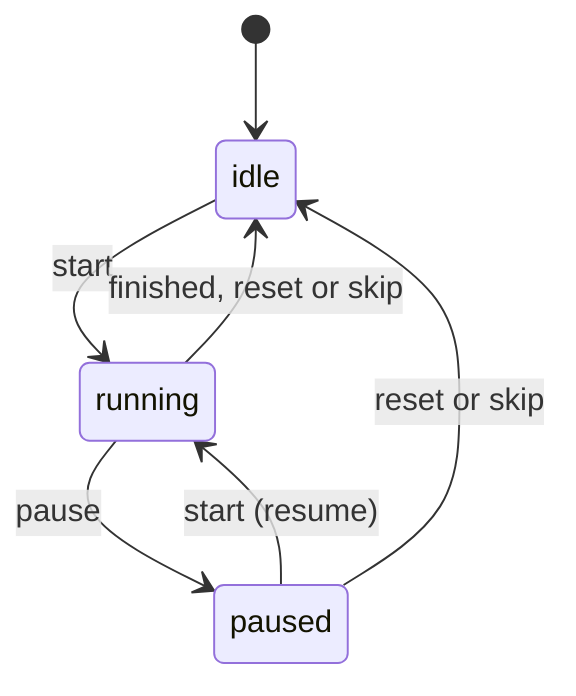
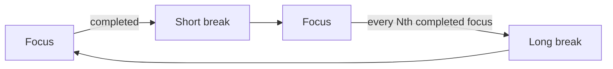

# ⏲️ Pomodoro Timer

A clean, dependency-free **Pomodoro focus timer** built with vanilla **HTML, CSS and JavaScript**. It has a circular progress ring, automatic focus/break cycles, customizable durations, sound and desktop notifications, daily stats, keyboard shortcuts and a unit-tested timer engine.

---

## Table of Contents

1. [Features](#features)
2. [What Is the Pomodoro Technique?](#what-is-the-pomodoro-technique)
3. [Tech Stack](#tech-stack)
4. [Project Structure](#project-structure)
5. [Getting Started](#getting-started)
6. [How to Use](#how-to-use)
7. [Settings](#settings)
8. [Architecture](#architecture)
9. [Testing](#testing)
10. [Deploying to GitHub Pages](#deploying-to-github-pages)
11. [Browser Support and Known Limitations](#browser-support-and-known-limitations)
12. [Commit History Guide](#commit-history-guide)
13. [Roadmap](#roadmap)
14. [Contributing](#contributing)
15. [License](#license)

---

## Features

- Three modes: **Focus**, **Short Break** and **Long Break**, each with its own color theme
- Animated circular progress ring that drains as time passes
- Automatic cycle: a long break after every N focus sessions, with dots showing your position in the cycle
- Start, pause, resume, reset and skip controls
- Customizable durations and cycle length, saved between visits
- Optional auto-start of the next session
- Pleasant end-of-session chimes generated in code (no audio files)
- Desktop notifications plus an in-page message
- Live countdown in the browser tab title, so you can watch it from another tab
- Daily stats: sessions completed and total focused time, reset automatically each day
- Keyboard shortcuts
- Accurate timing even when the tab is in the background
- Responsive layout, reduced-motion support and accessible labels
- Zero dependencies and no build step

---

## What Is the Pomodoro Technique?

The Pomodoro Technique is a time-management method that splits work into short, focused intervals separated by breaks.

| Step | What you do                                               | Default length |
| ---- | --------------------------------------------------------- | -------------- |
| 1    | Pick a task and work on it with no distractions (focus)   | 25 minutes     |
| 2    | Take a short break                                        | 5 minutes      |
| 3    | Repeat steps 1 and 2                                      | 4 times        |
| 4    | After the 4th focus session, take a long break            | 15 minutes     |

---

## Tech Stack

| Layer         | Technology                                 |
| ------------- | ------------------------------------------ |
| Markup        | HTML5 (semantic elements, ARIA attributes) |
| Styling       | CSS3 (custom properties, flexbox, SVG)     |
| Logic         | Vanilla JavaScript (ES2015+)               |
| Audio         | Web Audio API                              |
| Alerts        | Notification API                           |
| Persistence   | Web Storage API (`localStorage`)           |
| Testing       | Node.js built-in test runner (`node:test`) |

---

## Project Structure

```
pomodoro-timer/
├── index.html           # Page structure: ring, controls, stats, settings
├── css/
│   └── style.css        # Layout, ring, color themes, settings, toast
├── js/
│   ├── config.js        # Modes, default settings, limits, storage keys
│   ├── format.js        # MM:SS and "1h 30m" formatting helpers
│   ├── timer.js         # Timestamp-based Timer class (pure logic)
│   ├── cycle.js         # Mode durations and long-break scheduling (pure logic)
│   ├── storage.js       # Safe localStorage for settings and daily stats
│   ├── sound.js         # Web Audio chimes
│   ├── notifier.js      # Desktop notifications
│   ├── ui.js            # All DOM updates
│   ├── app.js           # Controller that connects everything
│   └── main.js          # Entry point: events and keyboard shortcuts
├── tests/
│   ├── format.test.js
│   ├── timer.test.js
│   ├── cycle.test.js
│   └── storage.test.js
├── package.json         # npm script (test)
├── .gitignore
├── LICENSE
└── README.md
```

---

## Getting Started

### Prerequisites

- Any modern web browser
- (Optional) [Node.js](https://nodejs.org/) 18 or newer, only needed to run the tests

### Installation

```bash
git clone https://github.com/<your-username>/pomodoro-timer.git
cd pomodoro-timer
```

### Run the app

**Option 1: open the file directly.**

```bash
# Windows
start index.html
# macOS
open index.html
# Linux
xdg-open index.html
```

**Option 2: VS Code Live Server.** Install the *Live Server* extension, right-click `index.html` and choose **Open with Live Server**.

**Option 3: any static server**, for example with Python:

```bash
python -m http.server 8000
# then visit http://localhost:8000
```

> Desktop notifications work best from `http://localhost` or an `https://` site (such as GitHub Pages). Some browsers restrict them when a page is opened as a plain `file://` URL. Sound and the in-page message work everywhere.

---

## How to Use

1. Press **Start** (or hit `Space`). The ring begins to drain and the countdown appears in the tab title.
2. When the session ends you hear a chime, see a message and (if allowed) get a desktop notification. The timer moves to the next mode on its own.
3. Use **Pause** to freeze the clock and **Resume** to continue.
4. Use **Skip** to jump to the next mode without counting the session, and **Reset** to restart the current one.
5. Click a mode tab to switch manually. If a timer is in progress you are asked to confirm.

### Keyboard shortcuts

| Key     | Action          |
| ------- | --------------- |
| `Space` | Start / pause   |
| `R`     | Reset           |
| `S`     | Skip            |

Shortcuts are disabled while you type in a settings field.

### Daily stats

Under the controls you see **sessions completed today** and **time focused today**. Only focus sessions that ran to zero are counted; skipped ones are not. The numbers reset automatically on a new calendar day.

---

## Settings

Open the panel with the ⚙ button. Values outside the allowed range are corrected automatically when you save.

| Setting                    | Default | Allowed range | Description                                      |
| -------------------------- | ------- | ------------- | ------------------------------------------------ |
| Focus (minutes)            | `25`    | 1 to 120      | Length of a focus session                        |
| Short break (minutes)      | `5`     | 1 to 60       | Length of a short break                          |
| Long break (minutes)       | `15`    | 1 to 90       | Length of a long break                           |
| Sessions before long break | `4`     | 2 to 8        | Focus sessions to finish before a long break     |
| Play a sound               | on      | on / off      | Chime when a session ends                        |
| Start next automatically   | off     | on / off      | Begin the next session without pressing Start    |

If you save settings while a timer is running or paused, the current session keeps its original length and the new durations apply from the next session. Settings and stats are stored in your browser's `localStorage`.

---

## Architecture

Each file has one job. The files that contain real logic do not touch the DOM, so they run both in the browser and in Node.js for testing.

| Module        | Responsibility                                         | Touches the DOM? |
| ------------- | ------------------------------------------------------ | ---------------- |
| `config.js`   | Constants only                                         | No               |
| `format.js`   | Turn numbers into text                                 | No               |
| `timer.js`    | Countdown state machine                                | No               |
| `cycle.js`    | Mode durations and what comes next                     | No               |
| `storage.js`  | Validate, load and save settings and stats             | No               |
| `sound.js`    | Generate chimes                                        | No               |
| `notifier.js` | Desktop notifications                                  | No               |
| `ui.js`       | Display values on the page                             | Yes              |
| `app.js`      | Decide what happens and tell the UI to show it         | Via `ui.js`      |
| `main.js`     | Attach events and shortcuts                            | Yes              |

Each file is wrapped in an IIFE and exports through `module.exports` (Node) or the `window.Pomodoro` namespace (browser). This avoids ES modules, which browsers block when a page is opened from `file://`.

### Why the timer uses timestamps

A naive timer subtracts one second every time `setInterval` fires. Browsers slow intervals down in background tabs, so that timer drifts and ends late. Here `Timer` stores *when it started* and *how much time was left at that moment*, and calculates the remaining time from the clock on every refresh. The screen refresh rate (every 250 ms) only affects how smooth the display looks, never how accurate the countdown is.

Every `Timer` method also receives `now` as an argument instead of reading the clock itself, which makes the class fully deterministic and easy to unit test.

### Timer state machine



### Session flow



A focus session that is **skipped** is not counted and never earns a long break.

### Design decisions

- **Settings validation in one place:** `sanitizeSettings` accepts anything (numbers, numeric strings, garbage) and always returns a valid object, so corrupt `localStorage` data can never break the app.
- **Optional features fail silently:** `localStorage`, notifications and audio may be blocked. Each is wrapped so the timer keeps working without them.
- **Mouse vs keyboard focus:** after a mouse click the button is un-focused so shortcuts like `Space` keep working, while keyboard users keep their focus position.
- **Midnight rollover:** stats carry a date key. A new day starts from zero even if the page stays open overnight.

---

## Testing

The pure logic is covered by unit tests using Node's built-in runner, so there is nothing to install:

```bash
npm test
```

(or simply `node --test`)

| Test file          | What it covers                                                                  |
| ------------------ | ------------------------------------------------------------------------------- |
| `format.test.js`   | `MM:SS` output, rounding up, negative values, hour/minute labels                |
| `timer.test.js`    | Countdown, pause, resume, double start, finishing, progress, reset              |
| `cycle.test.js`    | Duration conversion, long-break scheduling, skipped sessions, cycle dots        |
| `storage.test.js`  | Clamping, invalid input, corrupt data, missing storage, daily stats rollover    |

### Testing the UI quickly

Waiting 25 minutes is slow. Open the browser console and run:

```js
pomodoro.timer.reset(5000);  // make this session 5 seconds long
pomodoro.render();
```

Then press Start to see the full end-of-session flow (chime, message, switch to break, stats update) in five seconds.

---

## Deploying to GitHub Pages

Because this is a static site, deployment is free:

1. Push the repository to GitHub.
2. Go to **Settings → Pages**.
3. Under **Build and deployment**, choose **Deploy from a branch**.
4. Select the `main` branch and the `/ (root)` folder, then save.
5. After a minute the app is live at `https://<your-username>.github.io/pomodoro-timer/`.

---

## Browser Support and Known Limitations

Works in current versions of Chrome, Edge, Firefox and Safari on desktop and mobile. It needs ES2015 classes, SVG and `localStorage` (the app still runs without storage, it just cannot remember anything).

- **Background tabs:** the countdown stays accurate, but browsers may throttle timers in tabs left in the background for a long time, so the end-of-session alert can arrive up to about a minute late. Switching back to the tab corrects the display immediately.
- **Closing the tab** stops the timer. Settings and stats are saved, a running session is not.
- **Notifications** need permission and may be restricted on `file://` pages. Mobile browsers may not support them.
- **Sound** is only allowed after you interact with the page, so it is enabled the first time you press Start.

---

## Commit History Guide

The project was built module by module, one commit per step:

| #  | Type    | What it added                                              |
| -- | ------- | ---------------------------------------------------------- |
| 1  | `chore` | Repository initialization and `.gitignore`                 |
| 2  | `docs`  | Initial README skeleton                                    |
| 3  | `feat`  | HTML structure: ring, controls, stats, settings panel      |
| 4  | `style` | Base layout, mode tabs, progress ring and controls         |
| 5  | `feat`  | Central configuration                                      |
| 6  | `feat`  | Time and duration formatting helpers                       |
| 7  | `feat`  | Timestamp-based `Timer` class                              |
| 8  | `feat`  | Cycle logic (durations, long-break scheduling)             |
| 9  | `test`  | Tests for formatting, timer and cycle                      |
| 10 | `feat`  | Safe `localStorage` for settings and daily stats           |
| 11 | `test`  | Tests for settings validation and stats                    |
| 12 | `feat`  | Web Audio chimes                                           |
| 13 | `feat`  | Desktop notifications                                      |
| 14 | `feat`  | UI module                                                  |
| 15 | `feat`  | App controller                                             |
| 16 | `feat`  | Entry point, buttons and keyboard shortcuts                |
| 17 | `style` | Color themes, stats, settings panel, toast                 |
| 18 | `chore` | `package.json` with `test` script                          |
| 19 | `docs`  | This detailed README                                       |
| 20 | `chore` | MIT license                                                |

Commit messages follow the [Conventional Commits](https://www.conventionalcommits.org/) style.

---

## Roadmap

- [ ] Task list: attach a task to each focus session
- [ ] Weekly stats chart
- [ ] Custom sounds and a volume slider
- [ ] Light theme and a theme toggle
- [ ] Installable PWA with offline support
- [ ] Remember a running session across page reloads

---

## Contributing

Contributions are welcome.

1. Fork the repository
2. Create a feature branch: `git checkout -b feat/my-feature`
3. Make your changes and run `npm test`
4. Commit with a clear message: `git commit -m "feat: describe your change"`
5. Push and open a Pull Request

---

## License

Released under the [MIT License](LICENSE).